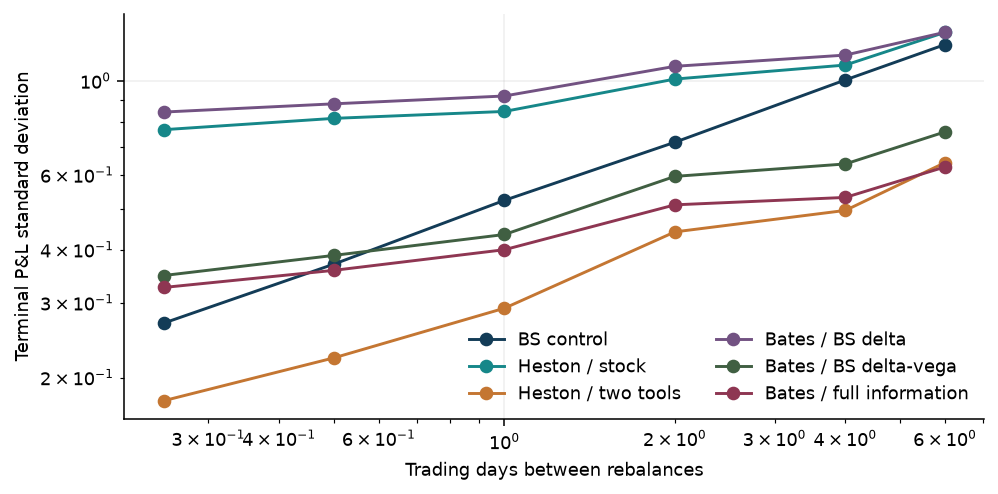
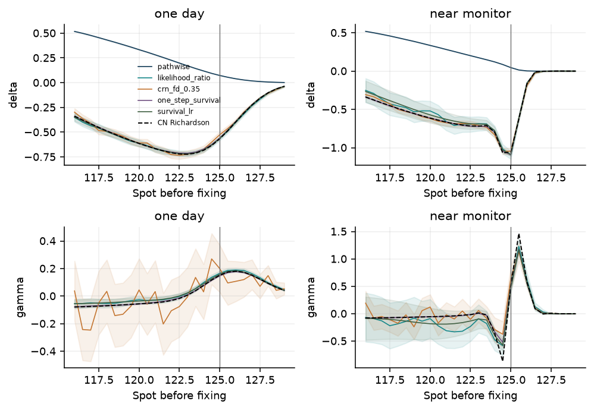

# Bates Hedging Laboratory

A Python research project on model risk in delta and delta-vega hedging. A synthetic Bates market generates option marks and observable quotes. Black–Scholes and calibrated Heston supply trader Greeks. True Heston, Black–Scholes and same-grid, full-information Bates controls identify the roles of instrument coverage, information and trading frequency.

| Experiment | Implementation | Evidence |
| --- | --- | --- |
| Pricing | COS, Carr–Madan FFT, full-truncation Euler, QE-M, Crank–Nicolson with Rannacher restarts, ADI and IMEX PIDE, PSOR and cross-fitted LSMC | Method-by-product errors, independent QuantLib tests, sensitivity to COS width and FFT damping |
| Calibration | Vega-weighted differential evolution and transformed LM, static quote filtering, matched masks, Hessian and profile likelihood | Clean and noisy Heston/Bates runs, parameter correlations, daily and weekly fallback logs |
| Greeks | Closed-form and CF differentiation, common-random-number finite differences, pathwise, LR, JAX AAD, survival smoothing | Bias, Monte Carlo variability and runtimes, two barrier monitoring cuts |
| Hedging | Fixed and daily IV, sticky delta, historical and oracle volatility, Heston minimum variance, delta-vega, no-trade band, local covariance projection | Shared paths, paired intervals, residual variance, cost frontier and jump-by-jump reconciliation |
| Attribution | Frozen hypothetical P&L, ATM-only risk revaluation, first and second order explain | Taylor and model gaps, jump-day distributions, 250-day MAR32 PLA |
| Commodity | Margrabe, Kirk, Bjerksund–Stensland, exact constant-correlation quadrature and Jacobi dynamics | Spread Greeks, approximation error and two-futures hedge comparisons |

## Run the project

Python 3.11 or later is required. The full configuration uses JAX on CPU. QuantLib is used by the test suite.

```bash
python -m pip install -e ".[dev,aad]"
make quick
make report
make verify
```

The corresponding Windows or make-free commands are below.

```powershell
python -m pip install -e ".[dev,aad]"
python -m quantproj --config experiments/quick.yaml --output output/quick
python -m quantproj --config experiments/full.yaml --output output/full
python -m pytest
```

The quick configuration runs every experiment family with small samples and disables JAX. The full configuration enables JAX and the five-step attribution. Daily calibration and barrier ADI in the hedging experiment dominate its runtime. Path counts and grids are controlled in the YAML files. Each run stores its effective configuration, dependency versions and per-module timings in the manifest. Hedging ledgers, P&L attribution paths, commodity hedge paths and calibration fits run in worker processes. The `workers` key in the YAML file sets their number, and `0` uses every logical CPU. The `--workers` option overrides it, and `--workers 1` runs serially. Each path and fit takes its randomness from fixed seeds or pre-drawn arrays, so every worker count gives identical artifacts apart from runtime columns. Workers use single-threaded BLAS. To regenerate only the report from a completed run, append `--render-only` using the same configuration and output directory.

## Read the results

The [validation PDF](report/model_validation.pdf), the [findings](report/findings.md) and the figures below come from the full configuration. The PDF follows the SR 11-7 headings and the findings report five numerical observations. On a 24-thread CPU the full run took about 29 minutes, of which hedging took 26. Run outputs are written under `output/`, which is not tracked. Regenerate them with the commands above.





| File | Interpretation |
| --- | --- |
| pricing.csv | European BS IV bp, American BS quote-equivalent IV bp, or barrier notional bp. The MC columns carry a standard error. |
| calibration.csv, profile.csv, calibration_diagnostics.json | Parameters, Feller margins, exact and Gauss–Newton curvature, representative profile fits and correlations. |
| quotes.csv, daily_calibration.csv | Spread coverage, deleted quote fraction, full/weekly/clean fit logs and failures. |
| greeks.csv, barrier_greeks.csv, aad_timing.csv | Algorithm results, sampling intervals and separate JAX compile/execution times. |
| hedge.csv, hedge_path.csv, paired.csv, hedge_variance_fit.csv | Final short-option P&L, paired bootstrap intervals, and zero-cost variance fits. |
| cost_frontier.csv, reconciliation.csv | Execution trade-offs and fixed-IV, jump-by-jump formula reconciliation on coupled simulation grids. |
| pnl_explain.csv, pla.csv, pla_zone_probability.json | Frozen P&L, Taylor residuals, market-model differences and per-path PLA classifications. |
| spread_prices.csv, spread_hedge.csv | Constant correlation pricing and dynamic Jacobi model controls. |
| manifest.json | Effective fixture, seed, package versions and run times. |

### Numerical conventions

- Default pricing and simulation use the same risk-neutral parameters. The heavier-tail B fixture matches expected annualized quadratic variation at all tenors. Jump timing, compensation and per-jump option revaluation use lognormal jumps.
- The spot and option hedges settle at fair synthetic marks plus explicit execution charges. Noisy quotes feed the hedge models. Stock costs are proportional and option half-spreads follow the unit-noise convention. Daily refreshes and tool rolls are calendar events. The spread, cleaning and benchmark assumptions are documented in the validation PDF.
- Discrete barriers are monitored at daily closes. Between fixings a surviving claim can have value above the barrier. The continuous analytic price is a separate numerical limit check. The market barrier grid is built by a backward IMEX solve.
- P&L signs are for a short option with hedge assets held long as indicated by their positions. CVaR is the mean loss in the worst 5% of sampled P&Ls. Negative fitted variance intercepts can occur in finite samples. Compare paired confidence intervals and the two reconciliation grids when interpreting the estimates.
- Calibration and risk-model variants share forward log-moneyness quote nodes. The synthetic PLA uses strict green thresholds of Spearman above 0.80 and KS below 0.09. Red means Spearman below 0.70 or KS above 0.12. Other finite pairs are amber. Each path contains 250 observations.
- The certainty of small-sample barrier, jump and calibration conclusions is limited. Model comparisons from full and quick configurations depend on their own path budgets and simulation schedules.

## Continuous integration

The [GitHub Actions workflow](.github/workflows/ci.yml) installs both development and AAD extras and runs Ruff, mypy, standard tests and the marked slow tests. When publishing the repository, configure its workflow badge with the repository URL. The [badge URL format](https://docs.github.com/en/actions/monitoring-and-troubleshooting-workflows/monitoring-workflows/adding-a-workflow-status-badge) uses the owner, repository and workflow filename.

## Method references

- [Basel Framework MAR32](https://www.bis.org/basel_framework/chapter/MAR/32.htm)
- [Federal Reserve SR 11-7 model validation guidance](https://www.federalreserve.gov/boarddocs/srletters/2011/sr1107a1.pdf)
- [Bjerksund and Stensland (2014)](https://doi.org/10.1080/14697688.2011.617775)
