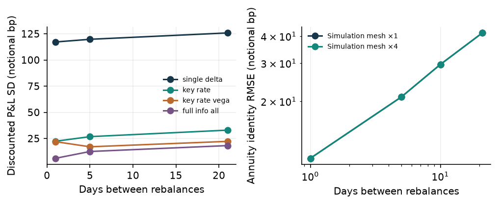
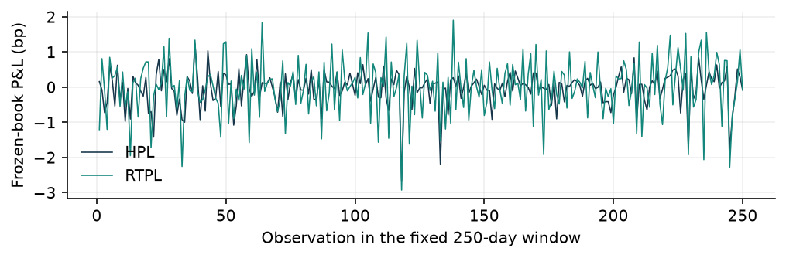

# Rates validation chapter

The [rates validation PDF](rates_validation.pdf) and the figures in this folder are copied from the full rates run. On a 24-thread CPU the run took about 50 minutes, of which the hedge ledgers took 45.

Generate the chapter from the project root with the rates CLI.

```cmd
.\.venv\Scripts\python.exe -m quantproj.rates --config experiments/rates/full.yaml --output output/rates/full
```

Use `quick` in place of `full` for the small smoke configuration. Use `--render-only` with a completed output directory to rebuild the same chapter.

The chapter covers the OIS bootstrap, normal-volatility pricing checks, Bermudan numerical benchmarks and primal-dual intervals, hedge books with realized coupons and stochastic funding, and 250-business-day frozen-position PLA. Its PDF, figures and input tables share the output directory.

## Full-run observations

- **Hedging.** Quote hedges bucket the 14 OIS key-rate nodes onto the hedge-swap maturities, so the parallel DV01 is preserved. In the base G2++ world, the three-swap key-rate hedge has a daily discounted P&L SD of 22 bp, against 117 bp for one-swap delta and 9 bp for the full-information swap control. In the second world, one swap is enough: key-rate delta is at 50 bp and single delta at 32 bp.
- **Vega hedging.** The key-rate plus vega hedge drops options that expire by the next rebalance and moves their vega to the next expiry. Its SD stays between 17 and 32 bp at daily, weekly and 21-day rebalancing in both worlds.
- **PLA.** With the frozen book hedged, the HW desk fails PLA on all 16 paths. It fails against noise-free true marks and also against a front-office G2++ that uses the same quote snapshot. A two-factor G2++ risk desk on that snapshot, with rounded structural parameters and a coarser grid, is green on all 16 paths (median Spearman 0.97).




